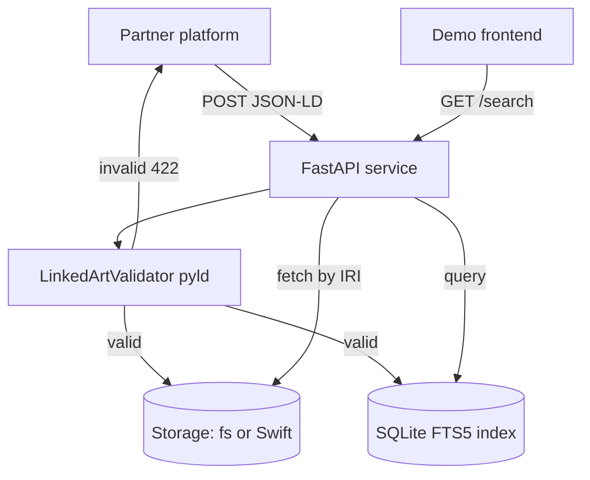

# Linked Art Interoperability Repository

A prototype **interoperability repository** for humanities data. Partner
platforms (stage performances, literature, art) publish
[Linked Art](https://linked.art/) JSON-LD artifacts to a shared repository via a
documented JSON API. A Python/FastAPI service validates each artifact against a
pragmatic Linked Art profile, stores it keyed by the partner's own IRI, and
indexes it for **cross-domain search**. A minimal web frontend demonstrates the
interoperability payoff by searching across all partners at once.

The system is **local-first**: it runs on a laptop with zero cloud dependencies
(filesystem storage + local SQLite index) and deploys to OpenStack against
Swift by changing only environment variables — no code changes.



## Local quickstart (no cloud needed)

Requires Python 3.11+.

```bash
# 1. Create a virtual environment and install dependencies
python -m venv .venv
source .venv/bin/activate            # Windows: .venv\Scripts\activate
pip install -r requirements.txt

# 2. Run the service (defaults to the local filesystem backend + SQLite)
uvicorn app.main:app --reload

# 3. In another terminal, load the bundled sample artifacts
python sample_data/load.py           # POSTs to http://localhost:8000

# 4. Open the demo
#    Frontend UI : http://localhost:8000/
#    API docs    : http://localhost:8000/docs
#    Health      : http://localhost:8000/health
```

Search for **`Beckett`** in the UI to see mixed results across performances
(`Activity`), literature (`LinguisticObject`) and art (`HumanMadeObject`), then
narrow with the type/partner filters. Click a result to see the stored JSON-LD
and a link back to the partner's original resolvable IRI.

> Data is written under `./data/` (git-ignored). Delete that directory to reset.

### Load a work from ACMI

Fetch [Frog Detective 3 from the ACMI Public API](https://api.acmi.net.au/works/125569/?format=jsonld)
and publish its JSON-LD to the running repository:

```bash
python sample_data/load_acmi.py
python sample_data/load_acmi.py https://api.acmi.net.au/works/75517/
python sample_data/load_acmi.py 75517
python sample_data/load_acmi.py --work-id 125569 --base-url http://localhost:8000
python sample_data/load_acmi.py --direct  # use configured storage without a running server
```

Full work URIs and numeric IDs are accepted positionally or via `--work-id` /
`--uri`. The fetch URL is normalised to `https://api.acmi.net.au/works/<id>/?format=jsonld`,
replacing any supplied query string or fragment.

The loader requires internet access to ACMI. It preserves the API payload and
work ID; partner inference assigns `acmi`. Re-running it creates a version only
if the fetched content has changed. Fetch or publish failures exit with status 1.

## Configuration

All configuration is via environment variables (or a local `.env` file).

| Variable | Default | Purpose |
|---|---|---|
| `STORAGE_BACKEND` | `fs` | `fs` (local filesystem) or `swift` (OpenStack). |
| `DATA_DIR` | `./data/artifacts` | Artifact directory when `STORAGE_BACKEND=fs`. |
| `INDEX_PATH` | `./data/index.sqlite3` | SQLite FTS5 index location. |
| `SWIFT_CONTAINER` | `artifacts` | Swift container name (swift mode). |
| `OS_AUTH_URL` | — | Keystone auth URL (swift mode). |
| `OS_APPLICATION_CREDENTIAL_ID` / `OS_APPLICATION_CREDENTIAL_SECRET` | — | Preferred Swift auth. |
| `OS_USERNAME` / `OS_PASSWORD` / `OS_PROJECT_NAME` | — | Alternative Swift auth. |
| `OS_USER_DOMAIN_NAME` / `OS_PROJECT_DOMAIN_NAME` | `Default` | Keystone domains. |
| `OS_REGION_NAME` | — | Optional Swift region. |

## API

Base path `/api/v1`. Full interactive docs at `/docs` (OpenAPI).

| Method & path | Description |
|---|---|
| `POST /api/v1/artifacts` | Validate and store a Linked Art artifact. `201` on success, `422` with structured errors on failure. Response reports `published_at`, `version_created` and `snapshot_of`. |
| `POST /api/v1/artifacts/validate` | Dry-run validation only; never stores. |
| `GET /api/v1/artifacts/{iri}` | Retrieve the current version's JSON-LD verbatim by URL-encoded IRI; `X-Published-At` header carries its publication date. |
| `GET /api/v1/artifacts/{iri}/versions` | List the full version history newest-first, each with `is_current`. `404` if the IRI is unknown. |
| `GET /api/v1/artifacts/{iri}/versions/{published_at}` | Retrieve a specific version (current or snapshot) verbatim by its URL-encoded publication date. |
| `GET /api/v1/artifacts` | Paged list with `partner`/`type`/`limit`/`offset`. |
| `GET /api/v1/search` | Cross-domain search: `q` (required) plus repeatable `type`/`partner`. |
| `GET /health` | Storage + index connectivity. |

Artifacts are identified by the partner's own `id` IRI (e.g.
`https://ausstage.org.au/event/12345`), which is preserved verbatim and remains
the lookup handle. See the plan/spec for the supported pragmatic Linked Art
type profile.

### Versioning & snapshots

Re-publishing an IRI whose content differs from the current version stores the
new version immutably and retains the previous one as a **dated snapshot**
(identified by its server-stamped UTC publication date). An identical
re-publish is an idempotent no-op (`version_created: false`) that creates no new
snapshot. Every version is `published_at` — that timestamp is both its identity
and its snapshot date — and snapshots are kept **indefinitely** and stay
retrievable via `GET .../versions/{published_at}`. Only current versions are
indexed, so search returns a single hit per artifact. The demo shows this off:
`sample_data/load.py` re-publishes an updated variant from
`sample_data/updates/`, and the frontend detail view lists the version history
and lets you open any snapshot.

## Docker

```bash
docker build -t linkedart-repo .

# Local mode (filesystem backend), data persisted on a named volume
docker run --rm -p 8000:8000 -v linkedart-data:/data linkedart-repo
```

## OpenStack / Swift deployment

The same image runs against Swift by switching the backend and providing
credentials — no code changes:

```bash
docker run -d -p 8000:8000 \
  -e STORAGE_BACKEND=swift \
  -e OS_AUTH_URL="https://keystone.example.org:5000/v3" \
  -e OS_APPLICATION_CREDENTIAL_ID="<id>" \
  -e OS_APPLICATION_CREDENTIAL_SECRET="<secret>" \
  -e SWIFT_CONTAINER="artifacts" \
  -e INDEX_PATH="/data/index.sqlite3" \
  -v linkedart-index:/data \
  linkedart-repo
```

Swift is the source of truth; the SQLite index is a rebuildable projection
(`RepositoryService.reindex()` re-derives it from stored objects). Keep the
index on a persistent volume so it survives restarts.

## Smoke test (works in both modes)

```bash
# health
curl -s localhost:8000/health

# publish a sample
curl -s -X POST localhost:8000/api/v1/artifacts \
  -H 'Content-Type: application/ld+json' \
  --data-binary @sample_data/artifacts/ausstage_event_12345.json

# search across domains
curl -s "localhost:8000/api/v1/search?q=Beckett"
```

## Tests

```bash
source .venv/bin/activate
pytest -q
```

Tests run entirely against the filesystem backend and a temporary SQLite index,
so no Swift/OpenStack access is required.

## Project layout

```
app/
  main.py            FastAPI app: lifespan wiring, routers, static frontend
  config.py          pydantic-settings configuration
  models.py          shared response/validation models
  partners.py        IRI host -> partner slug
  extract.py         label + searchable text extraction
  service.py         RepositoryService: validate -> store -> index (+ reindex)
  deps.py            FastAPI dependency accessors
  api/               health, artifacts (publish/validate/get/list), search
  validation/        LinkedArtValidator + offline JSON-LD context loader
  storage/           StorageBackend interface, fs_store, swift_store
  index/             SQLite FTS5 index
  web/               index.html + app.js demo frontend (with version history)
sample_data/         example artifacts per domain + loader script
  artifacts/         base artifacts (one per partner/domain)
  updates/           updated variants re-published to demo snapshotting
tests/               pytest suite (validator, storage/index, API, snapshots)
Dockerfile
requirements.txt
```

## Notes & limitations

- Validation is a **pragmatic profile** check (required fields, supported types,
  clean JSON-LD expansion against the bundled context), not full
  CIDOC-CRM/SHACL conformance.
- The Linked Art context is bundled offline at
  `app/validation/context/linked-art.json`; refresh it by re-downloading from
  `https://linked.art/ns/v1/linked-art.json`.
- No auth, rate limiting, or async ingestion — this is a demoable prototype.
